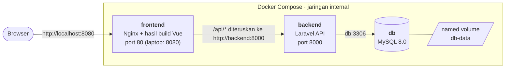
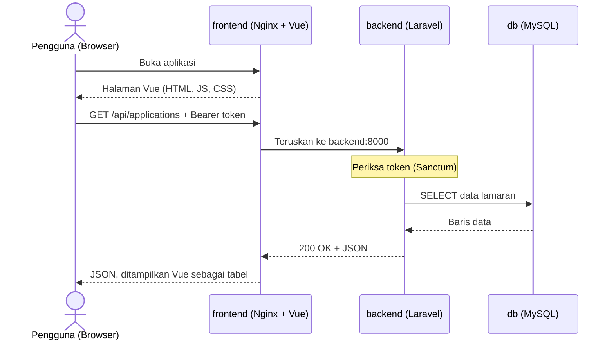

# Internship Application Tracker


Aplikasi web untuk mencatat dan memantau lamaran magang di satu tempat: perusahaan, posisi, status, dan deadline. Dibangun sebagai proyek Ujian Tengah Semester dengan fokus pada praktik DevOps: pengelolaan repository, CI/CD, containerization, dan orkestrasi dengan Docker Compose.

**Mulai cepat:** salin `.env.example` menjadi `.env`, isi `APP_KEY`, `DB_PASSWORD`, dan `DB_ROOT_PASSWORD`, lalu jalankan `docker compose up -d --build --wait`. Langkah lengkap ada di [Menjalankan proyek](#menjalankan-proyek).

## Daftar isi

- [Identitas](#identitas)
- [Latar belakang dan fitur](#latar-belakang-dan-fitur)
- [Teknologi](#teknologi)
- [Arsitektur dan alur data](#arsitektur-dan-alur-data)
- [Struktur repository](#struktur-repository)
- [Menjalankan proyek](#menjalankan-proyek)
- [Menjalankan tanpa Docker (pengembangan)](#menjalankan-tanpa-docker-pengembangan)
- [Ringkasan API](#ringkasan-api)
- [Pengujian](#pengujian)
- [CI/CD dan image Docker](#cicd-dan-image-docker)
- [Alur kerja Git](#alur-kerja-git)
- [Keamanan](#keamanan)
- [Pemecahan masalah](#pemecahan-masalah)
- [Cakupan pengerjaan](#cakupan-pengerjaan)

## Identitas

| | |
|---|---|
| Nama | Ayu Atikah |
| NIM | 24/545004/SV/25588 |
| Program Studi | D-IV Teknologi Rekayasa Perangkat Lunak |
| Universitas | Universitas Gadjah Mada |
| Mata Kuliah | Konstruksi dan Evolusi Perangkat Lunak |
| Keperluan | Ujian Tengah Semester, Semester Gasal 2026/2027 |

## Latar belakang dan fitur

Lamaran magang sering tersebar di catatan, chat, dan email. Akibatnya deadline terlewat dan status tiap lamaran sulit dilacak. Aplikasi ini memusatkan data tersebut dan menyediakan REST API yang dilindungi autentikasi token, dengan antarmuka web sederhana.

- Login dan logout dengan token (Laravel Sanctum).
- Daftar, tambah, ubah, dan hapus data lamaran.
- Validasi input dan kode status HTTP yang konsisten (200, 201, 401, 404, 422).
- Data lamaran dibagi untuk semua pengguna yang login.

Di luar cakupan: registrasi, reset password, peran pengguna, data per-user, unggah CV, notifikasi email, pencarian, dan pagination.

## Teknologi

| Lapisan | Teknologi |
|---|---|
| Backend | Laravel 12 (REST API), Laravel Sanctum, PHP 8.5 di container |
| Frontend | Vue 3, Vue Router, Axios, Vite |
| Database | MySQL 8.0 (lokal dan Docker Compose) |
| Web server frontend | Nginx 1.27 (menyajikan hasil build Vue dan meneruskan `/api`) |
| Container | Docker, Docker Compose |
| CI/CD | GitHub Actions |
| Registry | GitHub Container Registry (ghcr.io) |

## Arsitektur dan alur data

Browser hanya berbicara dengan `frontend`. Container ini meneruskan permintaan `/api/...` ke `backend`, dan `backend` terhubung ke `db`. Semua sambungan antar-container memakai nama service di jaringan Docker Compose, bukan alamat IP laptop.



Alur satu permintaan, misalnya membuka daftar lamaran:



Kode Vue hanya mengenal alamat relatif `/api` (dibaca dari `VITE_API_URL`), sehingga tidak ada alamat server yang tertanam di kode. Data disimpan di named volume `db-data`, jadi tetap ada setelah `docker compose down`.

## Struktur repository

```
.
├── backend/                  # Laravel API (Dockerfile, tes, migrasi, seeder)
├── frontend/                 # Vue.js (Dockerfile, nginx.conf)
├── .github/workflows/        # Workflow CI/CD (GitHub Actions)
├── docs/postman/             # Koleksi Postman
├── docker-compose.yml        # Orkestrasi db, backend, frontend
├── .env.example              # Contoh konfigurasi (tanpa nilai rahasia)
├── .gitignore
└── README.md
```

## Menjalankan proyek

Prasyarat: Docker Desktop (Compose sudah termasuk).

```bash
cp .env.example .env
echo "base64:$(openssl rand -base64 32)"   # tempel hasilnya ke APP_KEY di .env
# isi juga DB_PASSWORD dan DB_ROOT_PASSWORD di .env
docker compose up -d --build --wait
docker compose ps
```

Variabel di `.env` (dibaca oleh Docker Compose; berkas ini tidak ikut di-commit):

| Variabel | Fungsi |
|---|---|
| `APP_KEY` | Kunci aplikasi Laravel (wajib; hasil perintah `echo` di atas) |
| `DB_DATABASE`, `DB_USERNAME` | Nama database dan pengguna MySQL |
| `DB_PASSWORD`, `DB_ROOT_PASSWORD` | Sandi pengguna dan root MySQL (isi sendiri, wajib) |
| `BACKEND_PORT` | Port backend di laptop (bawaan `8000`) |
| `FRONTEND_PORT` | Port frontend di laptop (bawaan `8080`) |

Setelah ketiga container berstatus `healthy`:

| Layanan | Alamat |
|---|---|
| Frontend | http://localhost:8080 (atau nilai `FRONTEND_PORT`) |
| Backend API | http://localhost:8000/api (atau nilai `BACKEND_PORT`) |

Akun login dibuat otomatis oleh seeder saat backend start (lihat `backend/database/seeders/DatabaseSeeder.php`). Akun ini hanya untuk demo, dan kredensialnya dicantumkan di laporan, bukan di repository.

Menghentikan:

```bash
docker compose down      # container dihapus, data database tetap ada di volume
docker compose down -v   # juga menghapus data database
```

## Menjalankan tanpa Docker (pengembangan)

Prasyarat: PHP 8.2 atau lebih baru (dengan ekstensi `pdo_mysql`), Composer, MySQL 8 yang sedang berjalan, dan Node.js 22.

Backend:

```bash
mysql -u root -e "CREATE DATABASE pelacak_magang; CREATE DATABASE pelacak_magang_test;"
cd backend
composer install
cp .env.example .env
php artisan key:generate
php artisan migrate --seed
php artisan serve
```

Sesuaikan `DB_USERNAME` dan `DB_PASSWORD` di `backend/.env` dengan MySQL-mu. API berjalan di http://localhost:8000/api.

Frontend (terminal lain):

```bash
cd frontend
cp .env.example .env
npm install
npm run dev
```

Buka http://localhost:5173. Saat pengembangan, Vite meneruskan `/api` ke backend di `localhost:8000`.

## Ringkasan API

Semua endpoint kecuali login memerlukan header `Authorization: Bearer <token>`. Saat menguji dengan Postman, sertakan header `Accept: application/json`. Koleksi Postman ada di `docs/postman/`.

| Method | Endpoint | Keterangan | Respons gagal |
|---|---|---|---|
| POST | `/api/login` | Login, mengembalikan token | 401, 422 |
| POST | `/api/logout` | Logout, mencabut token | 401 |
| GET | `/api/applications` | Daftar lamaran | 401 |
| POST | `/api/applications` | Tambah lamaran (201) | 401, 422 |
| GET | `/api/applications/{id}` | Detail lamaran | 401, 404 |
| PUT | `/api/applications/{id}` | Ubah lamaran | 401, 404, 422 |
| DELETE | `/api/applications/{id}` | Hapus lamaran | 401, 404 |

Data lamaran:

| Field | Tipe | Aturan |
|---|---|---|
| `company` | teks | wajib |
| `position` | teks | wajib |
| `status` | enum | opsional (default `applied`): `applied`, `interview` |
| `deadline` | tanggal | opsional, format `Y-m-d` |

## Pengujian

Feature test backend dijalankan di folder `backend/`:

```bash
php artisan test
```

Test mencakup login, validasi, dan seluruh endpoint CRUD (kode 200, 201, 401, 404, 422), dan otomatis dijalankan oleh CI pada setiap Pull Request.

## CI/CD dan image Docker

Workflow berada di `.github/workflows/ci.yml`:

| Job | Berjalan pada | Fungsi |
|---|---|---|
| `backend-test` | push dan Pull Request ke `main`/`dev` | Menjalankan test backend, membangun image backend, dan menguji container-nya |
| `frontend-build` | push dan Pull Request ke `main`/`dev` | Membangun frontend, membangun image frontend, dan menguji seluruh sistem dengan Docker Compose |
| `deploy` | **hanya push ke `main`**, setelah dua job di atas lulus | Membangun image backend dan frontend, mengirimnya ke ghcr.io, lalu menjalankan ulang sistem dari image yang baru terbit |

Image diterbitkan dengan tag nomor commit (bukan `latest`):

- `ghcr.io/ayuatikahhh/pelacak-backend:<sha-commit>`
- `ghcr.io/ayuatikahhh/pelacak-frontend:<sha-commit>`

Image tidak berisi rahasia. `APP_KEY` dan `DB_PASSWORD` untuk job `deploy` disimpan di GitHub Secrets dan hanya dipakai saat container dijalankan. Pada Pull Request dan branch selain `main`, job `deploy` dilewati.

## Alur kerja Git

| Branch | Fungsi | Push langsung |
|---|---|---|
| `main` | Versi stabil | Tidak, hanya lewat Pull Request dari `dev` |
| `dev` | Integrasi seluruh fitur | Tidak, hanya lewat Pull Request dari branch kerja |
| `feature/…`, `fix/…`, `docs/…`, `ci/…`, `chore/…` | Pekerjaan harian | Ya (branch kerja, dihapus setelah merge) |

Aturan:

- Branch kerja dibuat dari `dev`, lalu digabung kembali lewat Pull Request dengan *merge commit*.
- Branch protection pada `main` dan `dev` mewajibkan Pull Request dan status check CI (`backend-test`, `frontend-build`) yang lulus sebelum merge.
- Tidak ada push langsung ke `main` dan `dev`.
- Pesan commit mengikuti [Conventional Commits](https://www.conventionalcommits.org/): `type: short description` (ditulis dalam bahasa Inggris), dengan tipe `feat`, `fix`, `docs`, `test`, `ci`, `chore`, `build`, dan `refactor`.

## Keamanan

- Tidak ada nilai rahasia di repository. Konfigurasi dibaca dari berkas `.env`, yang tidak dilacak Git.
- `.env.example` hanya berisi nama variabel dan nilai contoh.
- Nilai rahasia pipeline disimpan di GitHub Secrets.
- Image Docker tidak memuat rahasia; konfigurasi disuntikkan saat container dijalankan.
- Password akun seeder hanya untuk demo dan tidak dipakai di tempat lain.

## Pemecahan masalah

| Gejala | Penyebab dan solusi |
|---|---|
| `port is already allocated` | Port di laptop dipakai aplikasi lain. Ubah `FRONTEND_PORT` atau `BACKEND_PORT` di `.env`, lalu jalankan ulang `docker compose up -d --wait`. |
| `required variable ... is missing` | Variabel di `.env` belum diisi (`APP_KEY`, `DB_PASSWORD`, `DB_ROOT_PASSWORD`). |
| Backend `unhealthy` atau berulang restart | Lihat `docker compose logs backend`. Penyebab umum: `APP_KEY` kosong atau database belum siap. |
| `Access denied` dari MySQL setelah mengganti `DB_PASSWORD` | Sandi MySQL hanya dibaca saat volume dibuat pertama kali. Kembalikan sandi lama, atau hapus volume dengan `docker compose down -v` (data hilang). |
| Halaman `/login` menampilkan 404 setelah di-refresh | Konfigurasi Nginx (`try_files`) belum terpakai; bangun ulang dengan `--build`. |

## Cakupan pengerjaan

| Komponen | Status |
|---|---|
| Repository, branch, dan branch protection | ✅ |
| Backend API dan feature test | ✅ |
| Frontend Vue | ✅ |
| Workflow CI (dua job) | ✅ |
| Dockerfile backend dan frontend | ✅ |
| Docker Compose | ✅ |
| Build dan push image ke ghcr.io (job `deploy`) | ✅ |
| Nilai tambahan (FrankenPHP) | Tidak dikerjakan (opsional) |

## Lisensi

Proyek akademik. Tidak ada lisensi terbuka; seluruh hak dipegang penulis.